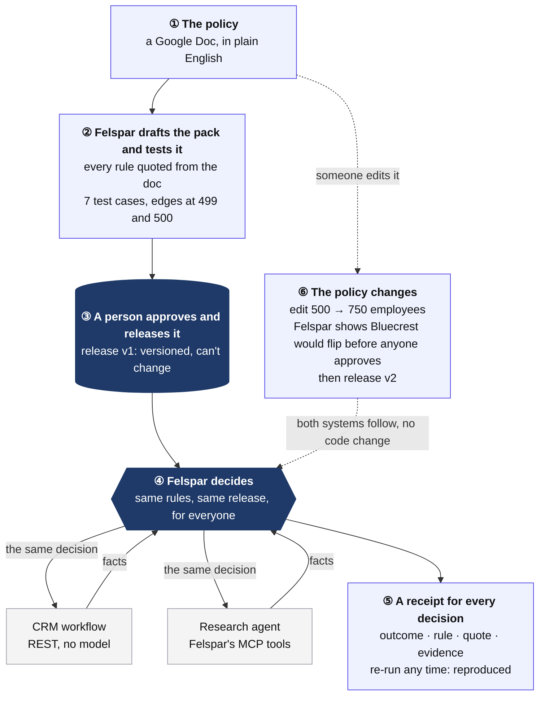
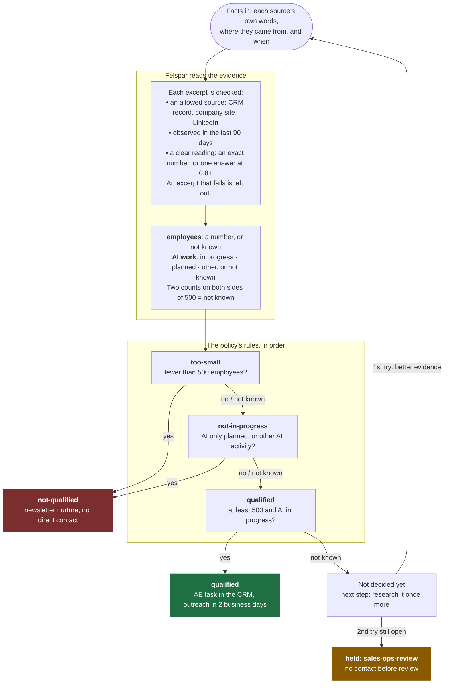

# A CRM workflow and an agent, one decision

Kestrel Analytics, a fictional company, qualifies sales leads with a one-page [policy](policy.md): at least 500 employees and an AI initiative in progress. Two systems qualify companies: a CRM workflow, with no model, and a research agent. Both ask Felspar, so both get the company's decision from the same released policy, never their own reading of it.

```text
$ npm run decide
kestrel-sales-qualification, release release-977472089907…

case  workflow (REST)          agent (MCP)              same?  teaches
A     qualified                qualified                yes    a clear yes stays a yes
B     qualified                qualified                yes    the case a change of the threshold would move
C     not-qualified            not-qualified            yes    a plan is not progress
D     held: sales-ops-review   held: sales-ops-review   yes    missing evidence is not a yes
E     not-qualified            not-qualified            yes    a clear no stays a no
F     held: sales-ops-review   held: sales-ops-review   yes    sources that disagree go to a person

$ npm run verify
A  qualified      reproduced  on release-977472089907…
B  qualified      reproduced  on release-977472089907…
C  not-qualified  reproduced  on release-977472089907…
E  not-qualified  reproduced  on release-977472089907…
```

D has no employee count, and F's sources disagree (450 and 900). Felspar doesn't guess either way: it holds them for sales operations, as the policy says.

## How it works

The policy is written once, released by a person, and every system that qualifies a company asks Felspar for the decision. When the policy changes, they all follow.



### How one decision is made

Neither system has any of this logic. Each sends facts; Felspar reads them and walks the released rules.



"Not known" is never a guess: D is held because nobody found its employee count, and F because its sources disagree. Each receipt names the rule that decided it, quoted from the policy.

## Run it

1. Copy [`policy.md`](policy.md) into a Google Doc and connect it in [Felspar](https://app.felspar.ai). Draft its pack with Felspar's plugin, then approve and release it.
2. In Workspace → Company agents, register an agent for `kestrel-sales-qualification` and copy its key.
3. `npm install` (Node.js 24.15 or later), then `cp .env.example .env.local` and paste in the key.
4. `npm run decide`, then `npm run verify`.

## What's in it

| File | What it does |
| --- | --- |
| [`cases.mjs`](cases.mjs) | Six companies and what their sources say, in their own words |
| [`decide.mjs`](decide.mjs) | Sends each company's facts through both consumers and compares the decisions |
| [`verify.mjs`](verify.mjs) | Asks Felspar to re-run each saved decision on the release that made it |
| [`policy.md`](policy.md) | The policy the pack is built from |

Both consumers send the same facts: what the CRM record and the company's site say, not a field someone filled in. The workflow calls the REST API with `@felspar/sdk`. The agent calls Felspar's `get_job_decision` tool over MCP, as any MCP agent would.

## Change the policy

Edit the threshold in the Google Doc, from 500 to 750 employees. Before anyone approves the change, Felspar's plugin shows which saved decisions it would flip: here, B, with 600 employees. After the new release, `npm run decide` gives the new decision in both consumers at once, with no change to either. `npm run verify` still reproduces the old receipts on the release that made them.

## Run it again

A decided company can be asked again any time. A held company gets two tries (the policy says to research once more), and one run uses both. After that, Felspar refuses with the escalation to follow, and the table still shows `held: sales-ops-review`.
